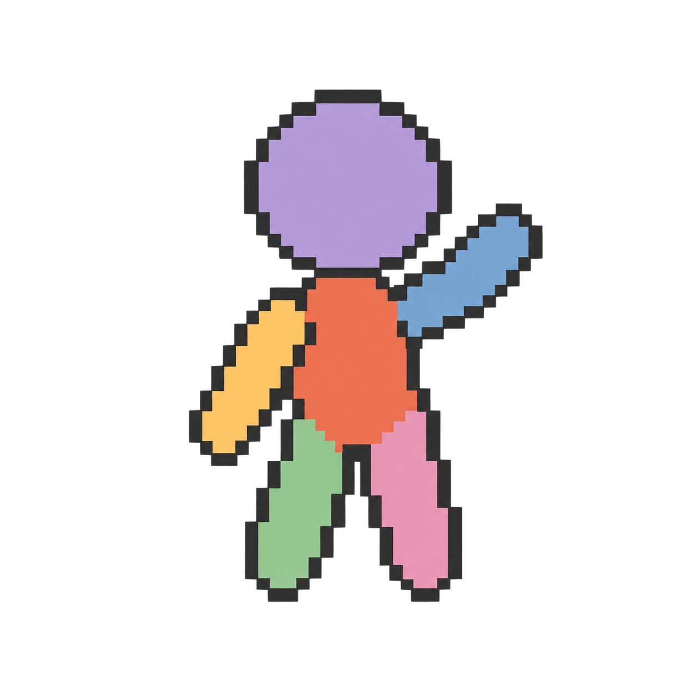

# FellowStudio3D



A desktop pixel-character posing and animation tool. Start with a motion, adjust
whole body parts, layer another motion, then export sprites. No keyframe editing
is required. The interface supports English (default), Simplified Chinese and
Japanese, with scalable pixel controls.

macOS (experimental source launcher): `sh ./FellowStudio3D.sh` with python.org Python 3.12+. First launch installs dependencies locally. [Setup and validation limits](docs/MACOS.md). Windows portable packages cannot run on Mac.

## User guides / 使用说明 / 使い方

[English](docs/GUIDE.en.md) · [简体中文](docs/GUIDE.zh-CN.md) · [日本語](docs/GUIDE.ja.md)

[v0.4.0 release notes / 更新说明](docs/RELEASE-v0.4.0.md)

**Tail controls** now use three FK joints with continuous skinning. Control root/middle/tip, drag their handles, blend a Tail motion layer, or author tail poses in pose cards. The sequence window uses a larger two-column layout with fixed action buttons.

Tail controls also offer independent root/middle/tip softness and bounce under Physics. Zero preserves the authored motion; settings travel with saved animations and use the same deterministic simulation for preview and export. Collision is not simulated.

Version 0.4.0 adds separate **Canvas size…** and **Lighting settings…** entries: independent native
width/height (32–256 px), stepped pixel lighting and optional model self shadows,
with light direction/elevation, strength and two colors. Expanding the canvas
preserves model/UV pixel scale; settings are saved with the project. Existing
projects retain the unlit 64×64 default.

The local development build adds a global **Retro animation** switch under **Animation style**: reuse small local pose changes while keeping active limbs moving. Preview and export share the same cels, with unchanged frame count and duration. [Design and limitations (Chinese)](docs/RETRO-ANIMATION.zh-CN.md).

The current UI organizes modeling into peer Shape/Hair/Ears/Tail/Props tabs, groups display settings above the preview, and remembers export choices for the app session. Existing exports can be replaced after confirmation with failure rollback. [UI framework and audit (Chinese)](docs/UI-DESIGN.zh-CN.md).

For offline reading, open `docs/GUIDE.en.html`, `docs/GUIDE.zh-CN.html` or
`docs/GUIDE.ja.html`. In the app, click **User guide** or press **F1** to open the
guide for the current interface language. All three guides cover the same workflow.

[Development and release guide](docs/DEVELOPMENT.md)

[Current feature inventory / 当前功能清单](docs/FEATURES.zh-CN.md) ·
[Iteration reports / 迭代报告](docs/ITERATION-REPORT.zh-CN.md)

[2026-10-26 earlier snapshot / 早间迭代快照](docs/START-HERE-20261026.zh-CN.md)

**Creation library…** has Motion and Character tabs. Three distinct starting models replace the repetitive variants. The private local package also includes the original Kumamon and painted cat, with their painting intact. **Create animation… → Save animation…** saves a reusable animation without character appearance; your files appear under My animations and can be applied to another character.

The source branch now also includes human/cat/long ears with linked editing and
their own texture cards, and a seamless mascot body with five shape controls,
soft upper-body movement and one body UV. Try `examples/models/PlushModel.json`.
These features are included in v0.3.0. Near-contact chin/chest outlines have also
been refined.

**Action sequence…** arranges up to six actions in order, including left/right
straight punches and push kicks. Choose frames per step and a transition, then
edit the generated ordinary motion layers. Character, base motion and pose
controls are retained; existing layers are replaced with one undo step. Try the
three recipes under `examples/motions/sequences`.

**Swim** adds breaststroke, front crawl and treading water; **Hover** provides
an airborne loop with height, bobbing, arm beats and leg bend. Choose them as a
base or layer them using the existing controls. Airborne poses are not pinned
to the floor. Seven editable examples cover swimming, hovering, waving while
floating, a floating mage and looking around while treading water.

**Export view → Four / Eight directions (level)** exports the current animation
from every direction in one background job. Transparent atlases use one row per
direction and include frame rectangles, timing and a common pivot in JSON.
Large atlases split into bounded-size pages automatically. Try the three ready
packs under `examples/atlases`; see [the atlas format](docs/DIRECTIONAL-ATLASES.md).

**Pose animation…** turns two to six editable pose cards into your own motion.
Capture a frame of the current animation, load a saved pose or start from a
built-in pose. Drag limbs in four views, mirror/reorder cards, and choose holds,
transitions and loop/once/hold playback. Apply is one undo step. Add normal
motion layers afterward, or reopen **Edit pose cards…** to refine the motion.
Try SideStepDance, GuardSignal and ShyGreeting under `examples/motions/posecards`.

**Held objects** use Box, Cylinder, Sphere and Cone shapes, with independent dimensions, grip, UV painting and pixel groups. Legacy weapon files remain readable but are no longer the primary examples.

**Single UV images** offer Save PNG, Copy texture (Ctrl+C) and Paste to replace
(Ctrl+V). Images retain native size and alpha; paste validates the UV size,
preserves protection groups and supports Undo/Cancel before Apply.

Version 0.2.0 adds tapered profiles and projecting faces, portable
pose layers, regional/timed blending, staged game actions and once/hold playback.
Try **Motion examples…** for editable recipes, or **Character model → Load model**
for the new shape examples. Existing Walk/Run defaults remain available.

It also adds waist twists, push kicks, pickup/put-down and overhead lifting,
real attack wind-up poses, signed directional controls and leg spread for squats.
Preview edits cancel obsolete work and reuse the motion calculation; IK joint
probes no longer rebuild the model on every iteration.
See [v0.2.0 release notes](docs/RELEASE-v0.2.0.md).

## Start

[Download the Windows portable ZIP](https://github.com/PotionCV/FellowStudio3D/releases/latest)
from Releases. GitHub's **Code → Download ZIP** contains source code, not the
bundled Windows runtime.

**Windows portable build:** extract the entire archive into a writable folder and
run `FellowStudio3D.exe`. The `.bat` remains available as a fallback. Keep `runtime`, `source`, `defaults` and the application
files together. No Python installation or Internet connection is required.

**Try the painted example:** open **Character model → Load model**, select
`examples/models/CustomModel.json`, then **Apply model**. Choose Walk or Run to
animate it. The model resource includes its painted textures and pixel groups.
To open the complete neutral-pose example instead, use **Open** with
`examples/characters/CustomCharacter.json`.

**From source (Windows, Python 3.12 tested):**

```powershell
python -m venv .venv
.venv\Scripts\python -m pip install -r requirements-lock.txt
.venv\Scripts\python app.py
```

The batch launcher uses `.venv` when present. Other Python versions may use
`requirements.txt`; they have not received the same Windows runtime checks.
Tkinter must be available. PNG drag-and-drop uses tkinterdnd2; file selection is
also available.

## Basic workflow

1. Pick a **Base motion**, or start from a pose. Use **Edit base motion** for its
   overall rhythm. Changing the base resets motion controls, preserving your
   model, textures and display preferences.
2. Select a body part on the left to change its pose throughout the motion.
   Add a motion layer and adjust its influence to combine actions.
3. Pause to drag IK handles. Click one of the four views to focus it. Model and
   UV editors use staged changes: **Apply** commits, **Cancel** discards.
4. Open **Character model** to set proportions and basic shapes. Hold **Before**
   to compare with the appearance when you opened the editor. **Single view**
   magnifies the focused view; double-click a view to toggle it.
   In **UV textures**, choose **Start / resume painting** and select a folder.
   The tool prepares the PNGs and opens that folder. Edit the PART.png files
   in your painting app; stable saves update the preview automatically.
5. Choose the export view, directory, name and formats. PNG frames and strips
   retain transparency; GIF is a preview. Output scales are **1x / 4x / 8x**.

The native canvas is **64 x 64**. Preview magnification and export scaling use
nearest-neighbor integer scaling; outlines are one native pixel wide. Three-
quarter views are level orthographic cameras; the Elevated view adds pitch.
Normal UV sampling can change small patterns during rotation. Optional pixel
protection groups preserve selected motifs within an angle range; occlusion and
silhouette clipping still apply. See the user guides above for detailed controls.

## Painting files and compatibility

Keep `UV_Model.json` beside your painting PNGs. Newly exported PNGs also carry
their part, UV chart and model-surface metadata. This checks **mapping compatibility**,
not whether a face or garment was drawn in the intended place. The card reports
matched layout, unknown source, waiting for a save, missing file or unreadable file.
PNG dimensions and transparent pixels alone cannot identify the correct UV map.
Bare PNGs with the right size are accepted with an unknown-source label.

Shape/size changes can alter the mapping even if the PNG canvas size stays equal.
Part placement and joint spacing do not change the part's UV chart. Old painting
files with a known incompatible surface are blocked. **Create adapted painting
copy** makes a new `-v2` / `-v3` folder; the old PNGs stay untouched. Inspect the
adapted motifs before continuing to paint. Invalid or partially written saves
never replace the last good embedded texture.

New unpainted characters share left/right limb artwork by default. Existing
painted characters retain independent sides. Uncheck **Share left texture** on
a right-side card to paint it independently; the current artwork is retained.
Shared artwork and protection groups follow later left-side edits. Pixel groups,
whole-pack import/export and reset controls are under **Advanced texture tools**.
Painting paths are local preferences, not dependencies of a shared character JSON.

## Projects and local data

Save a project JSON to share a character and motion. Imported textures and pixel
protection groups are embedded; the original PNG paths are not required to open
that saved project elsewhere. PNGs linked for live reload remain local to the
current editing session.

Autosave and UI preferences live in `user_data/`, which is excluded from Git and
release archives. Existing root-level sessions from older versions are copied
there on first launch without deleting the originals. Read-only installations
fall back to `%LOCALAPPDATA%\FellowStudio3D`. For a separate workspace, set
`FELLOWSTUDIO3D_DATA_DIR` before launching. UI scale, language, outline color and
the last export directory are local preferences, not shared defaults.

`examples/models` contains reusable model resources loaded through Character model >
Load model. DefaultModel and CustomModel include shape, embedded textures and
pixel protection groups. Apply model replaces the character while keeping the
current motion; Cancel discards the preview. Save model includes its textures.
Older shape-only presets remain supported and preserve the current textures.
`examples/characters` contains complete character projects opened through
Open, including their embedded UV textures and protection groups. DefaultCharacter
is the built-in character; CustomCharacter is a deliberately included painted
example. Both start from a neutral idle motion and do not change first-run defaults.
The included `examples/motions` and `examples/UV` are generated motion/template examples.
`source/Fellow1.png` through `Fellow3.png` are required internal base assets.
There are no runtime references to the developer's Works/Driller folders.

## Build and verify

```powershell
python -m unittest tests test_release -q
python -m unittest test_ui test_export_preferences -q
python tools/build_release.py
python tools/build_release.py --portable
```

Artifacts are written to `dist/`. Existing archives are never overwritten.
Both archive types use an explicit file list and include a SHA-256 manifest.
The source archive contains tests and developer tools; the portable archive
contains a private Windows x64 runtime. Personal sessions, export paths,
historical prototypes and review screenshots are excluded. The curated painted
example character is intentionally included.

No publishing, Git initialization or upload happens during a build.
FellowStudio3D is available under the [MIT License](LICENSE). Third-party terms
are documented in [THIRD_PARTY_NOTICES.md](THIRD_PARTY_NOTICES.md).

## Modular hair and ears

Head/Main body has separate Shape, Hair and Ears tabs. Build hair from named components: body, left/right fringe, left/right middle locks, back hair and ponytails. Components support independent shape, paint, mirror copies and bone animation. Hairstyle templates generate components once through a separate collapsed entry. See [hair workflow](docs/HAIR.zh-CN.md).
