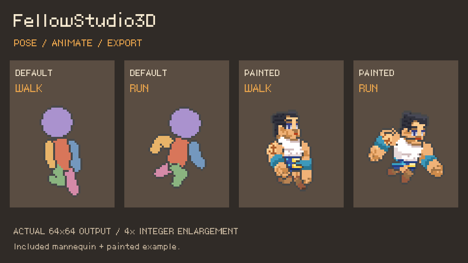
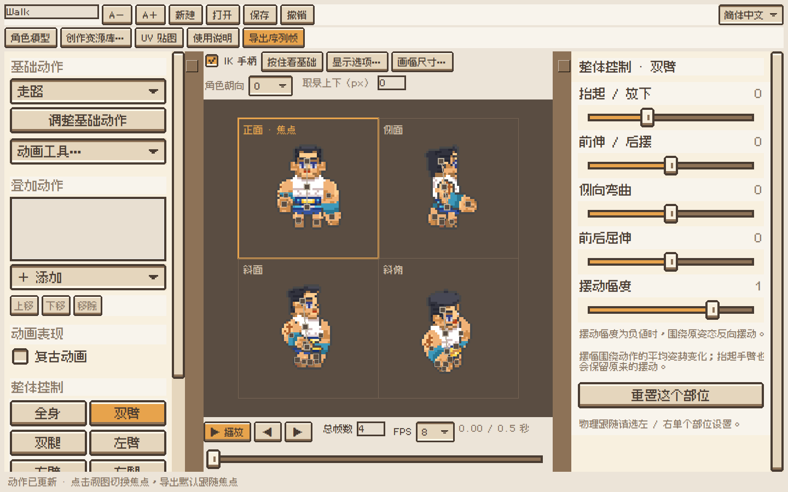
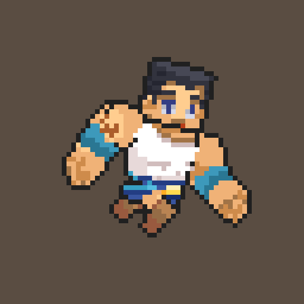
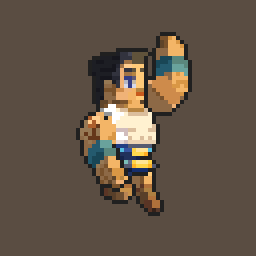
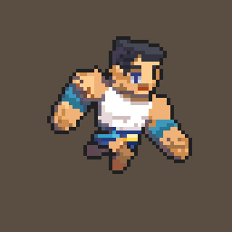
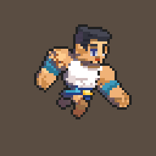
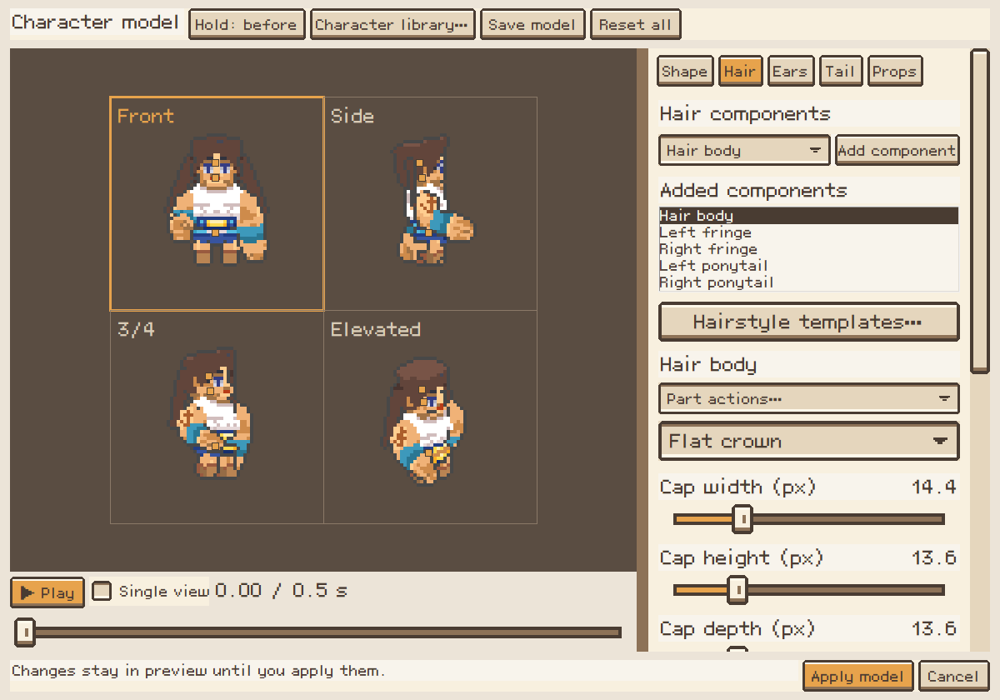
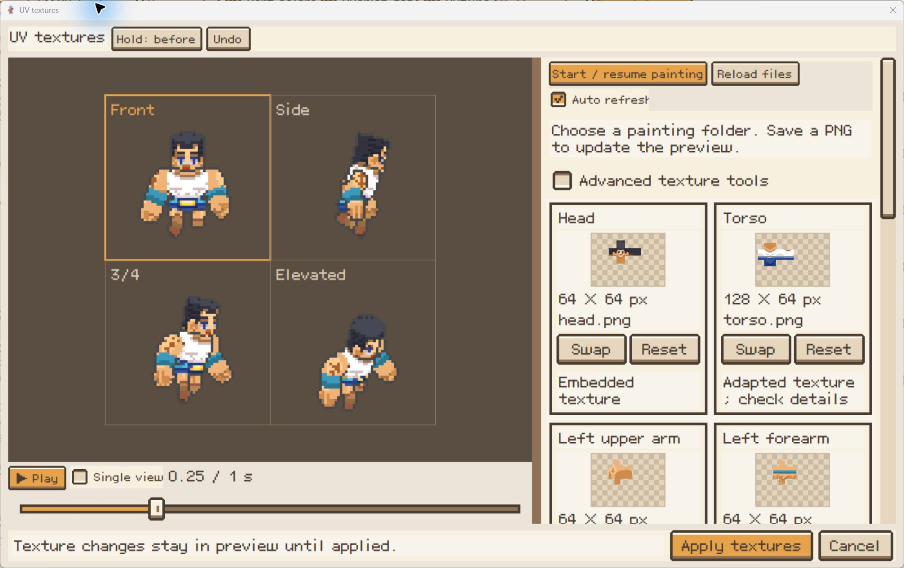

<div align="center">


# FellowStudio3D

### Pose in 3D. Create in pixels.

A small desktop workshop for pixel characters and animation.<br>
Start with a motion, make it your own, and export sprites — no animation experience required.

**[Download on itch.io](https://potionc.itch.io/fellowstudio3d)** · **[Quick start](#quick-start)** · **[User guides](#learn-more)**

Windows portable · macOS experimental · English / 简体中文 / 日本語



*One character, several views. Build a motion once and export it from different directions.*

</div>

## A character workshop, with pixels at the center

Pick a base motion, drag a hand or foot, blend another action, and watch all four
views update together. Change proportions, paint your own textures, and reuse
the same animation with another character.

选择角色 → 摆姿势与组合动作 → 绘制贴图 → 导出像素序列帧。



## See what you can make

<table>
<tr>
<td align="center" width="50%"><br><b>Build expressive actions</b><br>Combine movement with local pose adjustments.</td>
<td align="center" width="50%"><br><b>Shape the pixel lighting</b><br>Control light direction, colors and independent self shadows.</td>
</tr>
<tr>
<td align="center"><br><b>Keep it fluid</b><br>A smooth running example from the showcase.</td>
<td align="center"><br><b>Give it a classic rhythm</b><br>A reduced-drawing running example from the showcase.</td>
</tr>
</table>

These are selected showcase exports, not a list of bundled model presets.
The run examples illustrate different animation treatments; they are not a
controlled before/after benchmark of the Retro animation switch.

## Make it yours

| Create | What you can do |
| --- | --- |
| **Pose & animate** | Four-view IK handles, body controls, reusable motion layers, pose cards and action sequences. Walk, run, jump, swim, hover and more. |
| **Build a character** | Adjust body proportions; compose hair, ears, tails and geometric held objects. Mirror parts or link left/right edits. |
| **Animate the details** | Tail and hair joints, local motion blending, adjustable softness and bounce. |
| **Paint & protect** | UV PNGs for your painting app, live reload, texture copy/paste and protected pixel motifs. |
| **Choose the look** | Default 64×64 canvas, independent native dimensions from 32–256 px, one-pixel outlines, stepped lighting and separate self shadows. |
| **Set the rhythm** | Global **Retro animation** reduces drawing changes and reuses small local pose changes, consistently in preview and export. |
| **Export for games** | Transparent PNG frames and strips, GIF previews, four/eight-direction atlases with timing and pivot metadata. Integer scales: 1×, 4×, 8×. |

### Modular shapes, hair and ears

Build hair from independent components: body, fringes, side locks, back hair and
ponytails. Adjust, mirror and animate them. Shape, Hair, Ears, Tail and Props are
peer tabs in the model editor.



### Paint in the editor you already use

The UV workspace prepares PNGs for external painting and updates the character
when you save. Textures and protection groups are embedded in character files,
so sharing a character does not require the original painting folders.



*UV workflow screenshot from an earlier build; some toolbar labels have since changed.*

## Quick start

### Windows — portable build

1. Get the Windows ZIP from **[itch.io](https://potionc.itch.io/fellowstudio3d)**.
2. Extract the **entire** archive into a writable folder.
3. Run `FellowStudio3D.exe`. No Python installation or internet connection is needed.

Keep `runtime/`, `source/`, `defaults/` and the application files together.
`FellowStudio3D.bat` is also included as a fallback. GitHub's **Code → Download ZIP**
contains source code, without the Windows runtime.

### macOS — experimental source launcher

Install Python 3.12+ with Tcl/Tk, then run this inside the complete source folder:

```sh
sh ./FellowStudio3D.sh
```

First launch installs dependencies in a local environment and requires internet.
Font matching, adaptive UI sizing and Mac-specific option pickers are included.
Native Mac behavior is still being tested. **[Mac setup and troubleshooting](docs/MACOS.md)**.

### Your first animation

1. Choose a **Base motion**, then adjust a body part or add a motion layer.
2. Pause and drag IK handles; click a view to focus it.
3. Open **Character model** or **UV textures** to customize the character.
   **Apply** keeps staged changes; **Cancel** discards them.
4. Open **Export**, choose directions and formats, then save your sprites.

Try `examples/models/CustomModel.json` through the Character tab of the creation
library for the painted example, or open `examples/characters/CustomCharacter.json`
as a complete project. **Animation tools → Save animation** saves a reusable
motion without character appearance, ready to apply to another model.

## Learn more

**User guides:** [English](docs/GUIDE.en.md) · [简体中文](docs/GUIDE.zh-CN.md) · [日本語](docs/GUIDE.ja.md)

The app's **User guide** button / **F1** opens an offline HTML manual.

| Topic | Read more |
| --- | --- |
| Current capabilities | [Feature inventory / 功能清单](docs/FEATURES.zh-CN.md) |
| Hair and components | [Hair workflow](docs/HAIR.zh-CN.md) |
| Sprite atlas integration | [Directional atlas format](docs/DIRECTIONAL-ATLASES.md) |
| Retro animation | [Approach and limits](docs/RETRO-ANIMATION.zh-CN.md) |
| Interface organization | [UI framework and audit](docs/UI-DESIGN.zh-CN.md) |
| Changes | [v0.4.0 notes](docs/RELEASE-v0.4.0.md) · [Iteration reports](docs/ITERATION-REPORT.zh-CN.md) |

<details>
<summary><b>Projects, painting files and compatibility</b></summary>

Project JSON files embed textures and pixel protection groups. Live-linked PNG
paths stay local. Keep `UV_Model.json` beside exported painting PNGs: compatibility
checks identify known UV mappings, not whether artwork was drawn on the intended
part. Shape changes can alter mapping even at the same PNG size. **Create adapted
painting copy** preserves originals. New unpainted characters share left/right
limb textures by default; painted characters keep independent sides. Protection
preserves selected motifs within an angle range; occlusion and silhouette clipping
still apply.

Autosave and preferences live in `user_data/`, excluded from Git and releases.
Read-only installs fall back to a writable system app-data folder. Set
`FELLOWSTUDIO3D_DATA_DIR` for a separate workspace. UI scale and painting paths
are local preferences; native canvas dimensions belong to the project.

</details>

<details>
<summary><b>Run from source / build and verify</b></summary>

Windows, Python 3.12 tested:

```powershell
python -m venv .venv
.venv\Scripts\python -m pip install -r requirements-lock.txt
.venv\Scripts\python app.py
```

Other Python versions use `requirements.txt`; Tkinter must be available.
PNG drag/drop uses tkinterdnd2, with file selection as a fallback.

```powershell
python -m unittest tests test_extensions test_release test_platform_support -q
python -m unittest test_ui test_export_preferences -q
python tools/build_release.py
python tools/build_release.py --portable
```

Builds use an explicit file list and SHA-256 manifest, exclude personal sessions,
and never publish automatically. Artifacts go to `dist/`; existing ZIPs are not
overwritten. [Development and release guide](docs/DEVELOPMENT.md).

</details>

---

[MIT License](LICENSE) · [Third-party notices](THIRD_PARTY_NOTICES.md) · [Showcase media notes](docs/media/README.md)
